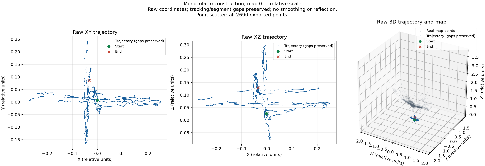

# CV-прототип MonoTrajectoryWeb

**Промпт 2 перевірено 1 листопада 2026 року у нативному WSL Ubuntu.** Реальні покадрові дані, фінальна підмножина траєкторії, точки й графік отримані; `validation.json`: `valid=true`, `data_valid=true`, `streaming_verified=true`, помилок немає. Ця сторінка фіксує історичний CV-етап; Промпти 3–4 завершено 02.11 без зміни ядра — див. [worker/PostgreSQL/API](backend-prototype.md) та [frontend](frontend-prototype.md).

## Перевірений baseline

31 жовтня 2026 року `mono_tum` успішно пройшов стандартний цикл `freiburg1_xyz` без viewer, зі стандартними shutdown та playback pacing. Код завершення — 0, зависання й тайм-ауту не було.

| Показник | Факт |
| --- | --- |
| Вхід | 798 RGB-кадрів, 640×480 |
| Результат | 38 валідних поз ключових кадрів; скінченні числа й норми кватерніонів перевірені |
| Час процесу | 44,027973 с: словник, читання кадрів, tracking/mapping, стандартний pacing, shutdown і збереження KF-траєкторії |
| Покадрові валідні пози | Baseline окремо не експортує; кількість не виміряна |
| Точки / проміжні JSONL | Baseline їх не експортує; кількість фінальних точок не виміряна |
| Початок першої спроби / baseline-успіх | 31.10.2026 12:10:38 / 12:48:52 Europe/Kyiv; 38 хв 14 с до baseline |

44,03 с зі стандартним pacing не є чистою швидкістю обчислення. 38 ключових кадрів не є кількістю валідних покадрових поз.

Докази: `/home/demus/.local/share/monotrajectoryweb/runs/baseline-upstream-20261031T1048/`. Локальні коміти: baseline — `e21d41d`; перевірений покадровий експорт — `0bcfe8b` (`feat(cv): export validated native monocular frames and sparse map`). Автор і комітер обох — `versal217 <versaldata@gmail.com>`. Експорт перевірено наступного дня; календарний розрив не є часом обчислення, сумарний активний час підготовки не відновлювався.

## Перевірений покадровий експорт

Запуск почався 01.11.2026 о 13:18:32,541 Europe/Kyiv (11:18:32,541 UTC), завершився з кодом 0 без тайм-ауту. Каталог: `/home/demus/.local/share/monotrajectoryweb/runs/export-verified-20261101-abi/`.

| Показник | Факт із JSON і незалежної перевірки |
| --- | --- |
| Повнота входу | 798 записів `type=frame`, IDs 0–797 і timestamps точно відповідають `rgb.txt`, без пропусків |
| Tracking / live-пози | 795 `OK`, 3 `NOT_INITIALIZED`; 689 узгоджених валідних поз; для 106 `OK`-кадрів опубліковане reference недоступне, поза явно `null` |
| Фінальна траєкторія | 458 валідних поз-підмножини в `map_id=0`, `segment_id=0` |
| Покриття числових записів | 795 збережено; 306 пропущено через недоступні/вилучені reference; 489 реконструйовано, з них 31 виключено через невалідний live snapshot |
| Фінальні точки | `total=exported=2690`, `limit=100000`, `truncated=false` |
| Live-точки | Максимум 2000 в одному записі; максимальний справжній total — 4207; metadata обмеження перевірені |
| Геометрія | Twc, скінченність, ортонормальність, determinant +1 та узгодженість quaternion xyzw перевірені для 1147 live/final матриць |

| Час | Секунди |
| --- | --- |
| Зовнішній процес / native total | 39,144386 / 38,363323 |
| Startup / processing | 6,378937 / 31,586229 |
| TrackMonocular, включно з числовим hook | 20,800955 |
| Upstream Shutdown request / очікування завершення | 0,001152 / 0,377027 |
| Два фінальні знімки | 0,003241 |

25,264 кадр/с — виміряний processing pipeline із декодуванням RGB, обробкою, snapshot і JSONL без playback pacing; це не гарантія чистої швидкості SLAM. Координати мають відносний масштаб; метричну точність і похибку відносно ground truth не оцінювали.

Незалежний observer прочитав повні записи під час живого процесу: 1, 30, 60, …, 780, 798 до появи final trajectory — 28 різних зростаючих кількостей у 29 спостереженнях. `mapper_started/finished`, `loop_started/finished` і `workers_finished=true`, `active_gba=0`. Одна точна перевірка **двох повних** знімків після завершення worker-ів підтвердила однакові geometry words; обидва digest — `3a1199df0253d237`. Підпис охоплює повну геометрію, включно з точками понад cap, не лише обмежений масив.



Графік побудовано з 458 final-поз і всіх 2690 експортованих точок, без згладжування, віддзеркалення чи downsampling; 103 розділені групи зберігають прогалини траєкторії. Масштаби осей рівні. Оригінал — `trajectory.png` у каталозі запуску; копія для звіту — `docs/figures/cv-trajectory.png` (475034 байти).

## Версії та розміщення

| Компонент | Зафіксована версія |
| --- | --- |
| Linux | Ubuntu 24.04.3 LTS, WSL2, x86_64 |
| Компілятор / CMake | g++ 13.3.0 / CMake 3.28.3; C++17 |
| OpenCV / Eigen / Boost | 4.6 / 3.4 / 1.83 |
| Ядро | Офіційний [ORB-SLAM3 4452a3c4ab75b1cde34e5505a36ec3f9edcdc4c4](https://github.com/UZ-SLAMLab/ORB_SLAM3/tree/4452a3c4ab75b1cde34e5505a36ec3f9edcdc4c4) |
| Pangolin | [v0.8 aff6883c83f3fd7e8268a9715e84266c42e2efe3](https://github.com/stevenlovegrove/Pangolin/tree/aff6883c83f3fd7e8268a9715e84266c42e2efe3) |

Точні Linux-пакети — `scripts/cv/ubuntu-packages.tsv`, Python-пакети native venv — `scripts/cv/requirements.lock`. Великі вихідники, build, datasets і runs лежать у `/home/demus/.local/share/monotrajectoryweb`; основний репозиторій не переносився й не дублювався. У межах Промпта 2 Docker, PostgreSQL, Nginx і вебчастина не запускалися; нативні БД/API/Nginx додані окремо у Промпті 3.

## Вхід і калібрування

Джерело — офіційна [TUM freiburg1_xyz](https://cvg.cit.tum.de/data/datasets/rgbd-dataset/download). [Параметри камер і формат](https://cvg.cit.tum.de/data/datasets/rgbd-dataset/file_formats). SHA-256 архіву: `a0236d97b8c30cd93b653656d2b6c293ff7c982a4130ef2a1a8beecdb124ef98`.

Витягнуто тільки `rgb/` і `rgb.txt`; depth та ground truth не подаються ядру. Калібрування — офіційне `Examples/Monocular/TUM1.yaml` на зафіксованому commit, без зміни розміру кадрів:

| Параметр | Значення |
| --- | --- |
| fx / fy | 517.306408 / 516.469215 |
| cx / cy | 318.643040 / 255.313989 |
| k1 / k2 / k3 | 0.262383 / -0.953104 / 1.163314 |
| p1 / p2 | -0.005358 / 0.002628 |

У `TUM1-bgr.yaml` змінено тільки `Camera.RGB: 0`, бо `cv::imread` повертає BGR. Intrinsics і дисторсія незмінні. SHA-256 YAML: `7e102220272166ff3afc8d15be49be8a5ca03f1823bf31119468ee2b984b9ba9`.

## Патчі та усунений збій

- `orbslam3-cxx17.patch` — тип лічильника GBA `bool → int`, необхідний через заборону `++bool` у C++17.
- `orbslam3-headless.patch` — лише `bUseViewer=false` у `mono_tum`.
- Pangolin збирається з локальним `-include cstdint` для GCC 13; його вихідники незмінні.
- Upstream-порядок Shutdown незмінний; власний shutdown-патч не застосовується. Snapshot-патч додає числові записи кадрів, узгоджені копії геометрії та спостереження завершення потоків, без переписування tracking/mapping. Після кадрів owner очікує завершення з опитуванням через 2 мс; це не демонстраційна затримка й не pacing обробки.
- Окремий export driver працює без viewer і playback pacing. Бібліотеки знаходяться через локальний `LD_LIBRARY_PATH` дочірнього процесу, без глобального `ldconfig`.

Початковий експорт завершувався `SIGSEGV` (код -11) після кадрів; gdb локалізував збій у `GetMonocularSnapshot`. Виявлено Eigen ABI mismatch між core з `-march=native` і драйвером з типовими прапорцями: alignment 16/32, розмір frame-pose 80/96, offset матриці 16/32 байти. Виправлення — відповідний `-march=native` для `mono_export` і перекомпіляція лише драйвера. Версії core/залежностей не змінювалися; SHA-256 бінарних DBoW2, g2o та Pangolin до/після виправлення незмінні.

## Відтворення

PowerShell, робоча папка поточного репозиторію:

```powershell
wsl -d Ubuntu --exec bash scripts/cv/build-export-wsl.sh
wsl -d Ubuntu --exec bash scripts/cv/run-export.sh
```

Підготовлені залежності повторно збирати не потрібно. Native venv уже готовий; лише якщо його немає:

```powershell
wsl -d Ubuntu --exec bash scripts/cv/setup-python-wsl.sh
```

`run-export.sh` створює новий каталог без перезапису, спостерігає JSONL і запускає аналізатор з незалежним `rgb.txt`. Артефакти: `snapshots.jsonl`, `trajectory.json`, `map_points.json`, `native-summary.json`, `run-summary.json`, `validation.json`, `trajectory.png`. Для окремого стандартного прикладу з pacing: `wsl -d Ubuntu --exec bash scripts/cv/run-baseline.sh`.

## Межі перевірки

Конвенція — `Twc = inverse(Tcw)`, quaternion у порядку xyzw. Невалідні/недоступні пози позначені `null`; різні карти/сегменти та прогалини не з’єднуються на графіку. Перевірено лише одну реальну карту/сегмент, не всі reset/multi-map сценарії. П’ять stdlib unittest-перевірок point metadata/truncation пройшли у native venv; реальний final-масив у цьому запуску не обрізався.

Усі вихідні кадри мають записи, але final-пози є явно облікованою підмножиною через недоступні reference та невалідні live-пози. На момент завершення Промпта 2 R1–R8 були заплановані. Після окремо дозволених Промптів 3–4 додані відеовхід, БД/API, нативні compute та UI; актуальні статуси — у [requirements.md](requirements.md). Паралельне балансування ще заплановане.

Push не виконувався.
