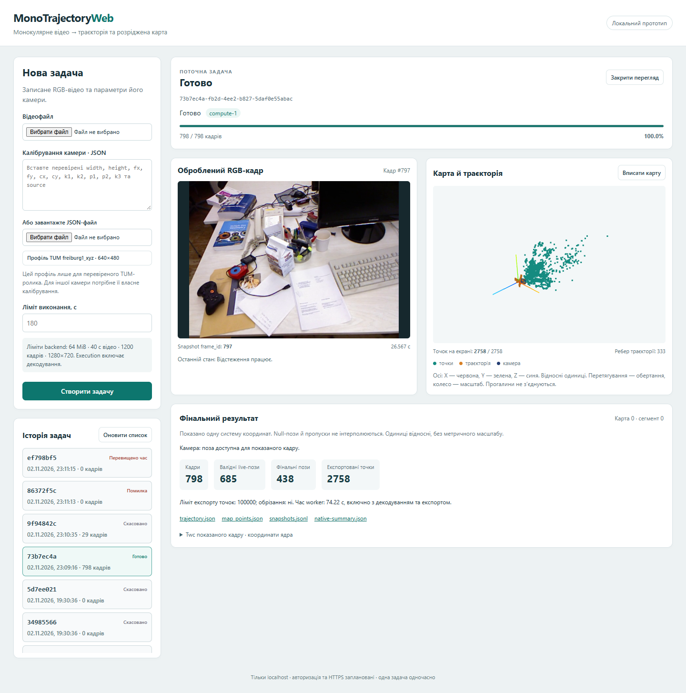

# Промпт 4: інтерфейс і поступова карта

**Перевірено 02.11.2026. Промпт 4 завершено; Промпт 5 не виконувався.** Застосунок: **http://127.0.0.1:8080**. React/TypeScript/Vite та Three.js працюють з реальним API й наявним ORB-SLAM3; демонстраційних координат або таймерної анімації немає. Авторизація/HTTPS, паралельне R5, ETA, автомасштабування та адміністрування залишаються запланованими.



## Запуск

У поточному підготовленому середовищі, PowerShell у робочій папці:

```powershell
wsl -d Ubuntu --exec bash scripts/build-ui
wsl -d Ubuntu --exec bash scripts/start
wsl -d Ubuntu --exec bash scripts/status
```

Якщо UI-залежності ще не встановлено, спочатку `wsl -d Ubuntu --exec bash scripts/setup-ui`. Скрипт перевіряє запас місця, завантажує офіційний Node 24.22.2 з перевіркою SHA-256 і встановлює pinned package-lock у native WSL. Залежності — `~/.local/share/monotrajectoryweb/frontend-deps`, Node — `tools`, cache — `npm-cache`, результати build — `web/ui`; великих node_modules/build у OneDrive немає. Основний репозиторій не переноситься й не дублюється. Версії: React 19.3.1, TypeScript 7.0.2, Vite 8.3.5, Three.js 0.187.0.

Наявні CV-ядро, залежності, `-march=native` й shutdown не змінено та не перебудовано. Нативні runtime-бібліотеки перевірено за попередніми SHA-256. При оновленні вже запущеного Python-коду потрібен перезапуск власних API/compute/dispatcher без активних задач:

```powershell
wsl -d Ubuntu --exec bash scripts/stop dispatcher api compute-1 compute-2
wsl -d Ubuntu --exec bash scripts/start
```

Власний Nginx на 8080 віддає UI; `/api/` і health/OpenAPI проксіюються на API. `scripts/start` перевіряє й перезавантажує лише власний Nginx. PostgreSQL та збережені дані при цьому не скидаються. Усі project listeners залишаються на localhost.

## Дані й відображення

- Форма приймає відео та явний calibration/parameters JSON; можна вставити текст або імпортувати файл. TUM-профіль підставляється тільки окремою дією для freiburg1_xyz 640×480. Порожня форма не має прихованого калібрування. Повторний імпорт того самого JSON перевірено.
- `GET /api/config` повертає фактичні серверні ліміти й інтервал snapshot 500 мс. POST створює задачу; UI показує UUID, server_id, стан/етап, processed_frames і total_frames лише коли загальний обсяг відомий. Черга/декодування не підмінюються відсотком за таймером.
- Для відкритої активної задачі один послідовний цикл отримує status і невеликий snapshot приблизно двічі на секунду. Запити не накопичуються. Закриття перегляду/сторінки, приховування вкладки й термінальний стан припиняють polling; in-flight fetch скасовується. Після помилки показано повідомлення й ручне поновлення, без нескінченних retries.
- RGB-кадр спочатку завантажується й декодується, перевіряється `X-Frame-Id`, і тільки потім кадр та snapshot одночасно потрапляють у React state. При перемиканні задач старий кадр/карта не показуються під новим UUID. Hash-посилання `#jobs/<UUID>` зберігає вибір після reload.
- Live-карта використовує тільки точки й пози snapshot. Збережено null, tracking_state, map_id/segment_id і прогалини. Лінія існує тільки між валідними сусідніми frame_id однієї карти/сегмента. Історичні live-оцінки не видаються за фінальну оптимізовану траєкторію.
- Після success manifest і два фінальні JSON-артефакти читаються один раз, окремо від polling. Raw JSONL автоматично не завантажується. Фінальний camera marker береться з фінальної пози саме показаного кадру; за відсутності такої пози маркер прихований. Кількості live-поз і фінальних поз підписані окремо.

Перетворення координат: `p_scene = C p_world`, де `C=diag(1,-1,-1)` — поворот на 180° навколо X, determinant +1. Для камери `C4=diag(1,-1,-1,1)` і `T_scene = C4 Twc C4^-1`; JSON-матриця row-major переноситься у Three.js з transpose. Frustum має локальний forward −Z. Це узгоджене перетворення точок і пози, без випадкового віддзеркалення однієї осі. Масштаб всюди **відносний**, не метри.

Сцена має фіксовані буфери максимум 5 000 точок і 1 200 поз; у live snapshot доступно не більше 256 точок і 240 записів історії. Для великої фінальної карти вибірка детермінована, беруться справжні точки без вигадування координат. Знаменник лічильника карти — кількість доступних точок snapshot/експорту. Геометрія оновлюється на місці; малювання — при нових даних, resize або дії OrbitControls, без постійного animation loop. При unmount звільняються геометрія, матеріали, controls, ResizeObserver, WebGL context і blob URLs. Drawing buffer обмежено 2 млн пікселів, pixel ratio — максимум 1,5.

## Нові задачі й тимчасові кадри

Існуючі **29 задач не очищалися**: перевірено список файлів, розміри/mtime їхніх каталогів і наявність записів у БД. Тільки нові API-задачі отримують `frame-work-policy.json`.

Перед публікацією snapshot відповідний завершений PNG атомарно зберігається hardlink у `previews/`. Зберігаються всі опубліковані кадри, щоб повільний або in-flight запит старішого snapshot також міг отримати правильне зображення. Це невелика підмножина вхідних кадрів, а не друга повна копія декодування.

Лише після `wait()` worker і перевірки порожньої process group compute прибирає `sequence/rgb`. Відео, rgb.txt, калібрування, preview, JSONL, наявні фінальні результати та логи залишаються. Видалення перевіряє UUID/розташування каталогу, назви всіх файлів і відмовляється працювати із symlink або невідомими файлами. Старі задачі без marker залишаються у початковому layout. Це cleanup одного запуску, окремої системи керування сховищем чи видалення історії немає.

| Нова задача | Фінальний стан | Прибрано робочих PNG | Збережено previews |
| --- | --- | ---: | ---: |
| `73b7ec4a-fb2d-4ee2-b827-5daf0e55abac` / compute-1 | succeeded | 798 | 61, поточний frame_id 797 |
| `9f94842c-be3e-444f-803b-8d3723189f1a` / compute-2 | cancelled під час tracking | 798 | 4, поточний frame_id 28 |
| `86372f5c-82f4-49c5-b69c-2d7ffb934392` / compute-1 | failed / InvalidDataError | 0 | 0 — tracking не почався |
| `ef798bf5-9bdc-43c8-a91c-e2d26a14d72d` / compute-2 | timed_out під час decode | 10 | 0 — tracking не почався |

Усі групи процесів цих задач порожні; директорій робочих PNG після завершення немає. Перегляд success і cancel після cleanup/reload працює; перевірено також доступ до раніше опублікованого preview успішної задачі. Наявні 29 записів і каталоги збережено, разом стало 33 задачі. Резерв backing volume **5 GiB** не знижувався; pagefile/hiberfil і параметри VHDX не змінювалися.

## Фактичне приймання

Повний браузерний прохід: Chrome 156.0.8078.74, Playwright-core 1.64.1, окремий headless-профіль Windows Chrome, 02.11.2026 23:09:14–23:11:17 Europe/Kyiv. Доступ сторінки обмежено localhost; сторонні відповіді чи SLAM mock-дані не використовувалися. Після фінальних уточнень без нових обчислень повторно відкрито всі чотири результати, перевірено повторний імпорт JSON та 404-помилку із зупинкою polling.

Перевірено:

- Через браузер завантажені наявний TUM H.264-ролик і його JSON калібрування. Успішно отримано 798 frame-записів, **685 валідних live-поз**, **438 фінальних поз**, **2 758 точок**, cap 100 000, truncated=false. Результати можуть відрізнятися від попередніх запусків, без підміни поз.
- До завершення показано **51 різний frame_id** і 50 різних наборів точок. Наприклад, frame 21: 256 точок / 11 ребер; frame 71: 256 точок / 43 ребра. Перевірено 640×480, збіг підписів кадру та правильну кількість видимих точок/розривів із отриманим snapshot; PNG карти змінювався.
- За цих оновлень число активних WebGL buffers залишалося 6; нових buffers на кожен snapshot не створювалося. Після закриття активного перегляду — 0 canvas, 0 активних buffers, 12 створених/12 видалених, контексти звільнені. Polling припинився; повторне відкриття тієї самої задачі працює.
- Після terminal немає подальшого polling; reload показує фінальну карту та preview вже після cleanup. Перевірено ширину 390 px без горизонтального переповнення, збережено mobile screenshot.
- Cancel через кнопку дав 202 і стан «Скасовано», без втраченого preview. Пошкоджене відео показало реальну помилку decoder; timeout — «Перевищено час». За відсутнього total_frames прогрес у цих кінцевих станах не залишається indeterminate.
- Невалідний JSON калібрування не створює задачу. Запит неіснуючої задачі дає видиму HTTP 404 і припиняє polling. Повторні переходи між збереженими задачами не змішують UUID/кадри.
- Фінальний `build-ui`: TypeScript і production Vite build успішні, 4 тести геометрії/даних пройшли. JS main 238,44 kB, lazy MapView 558,87 kB, CSS 5,98 kB. Backend: 14 unittest пройшли, зокрема legacy guard, активна process group, preview hardlinks, непередбачені файли/symlink та очищення після ранньої помилки.

Час worker успішного відео — **74,220 с**, із них decode 33,797 с. Це startup, декодування, SLAM, JSONL/snapshot, shutdown/quiescence й фінальний export/validation, не чистий час SLAM. Job execution 75,590 с включає також роботу менеджера та cleanup. Runner залишився без pacing, штучних затримок обчислення не додано.

На кінцевому контрольному замірі C: **15,47 → 14,30 GiB** вільно; native FS — **942,319 → 942,141 GiB**. Це фактичні знімки, не приписування всіх змін диска лише проєкту. Збережені результати/відео й опубліковані previews надалі займають місце; автоматичного retention для них немає.

Повні докази поза Git у `web/reports/`: `prompt4-baseline.json`, `prompt4-verification.json`, `prompt4-browser/report.json`, `prompt4-browser/smoke-report.json` і screenshots. Поточний невеликий перевірений screenshot додано у `docs/figures/frontend-result.png`.

Повторення browser suite з PowerShell потребує вже підготовлених UI-залежностей, наявного успішного TUM job і тестового MP4/JSON. Windows Node використовує встановлений Chrome, браузер не завантажується:

```powershell
node --experimental-strip-types frontend/tests/browser.mjs
# Після повного проходу: тільки читання збережених результатів, без нових CV-задач
node --experimental-strip-types frontend/tests/browser.mjs --smoke
```

Для іншого розташування native-сховища задається `MTW_TEST_NATIVE`, за потреби — `MTW_EXISTING_JOB`. Повний suite створює рівно чотири нові задачі; не запускай його повторно без потреби. Цього разу SLAM реально запускався один раз до успіху й один раз до скасування; інші два випадки закінчилися на decoder, ядро/залежності не перебудовувалися.

Межі: перевірено один TUM-ролик та одну карту/сегмент; розриви й multi-map відокремлення додатково перевірені unit-тестом. Це не вимірювання точності чи всього споживання RAM/GPU браузером. Потрібен WebGL 2; JSON results/snapshots мають серверні та екранні ліміти. Авторизація/HTTPS, ETA, повне паралельне R5, адміністрування й автомасштабування ще не реалізовані.

Коміти коду: `8843c15` — preview/cleanup нових задач; `42b4089` — UI, нативна збірка та browser checks. Автор і комітер обох — `versal217 <versaldata@gmail.com>`, ідентичності перевірено перед кожним комітом.

Push не виконувався.
