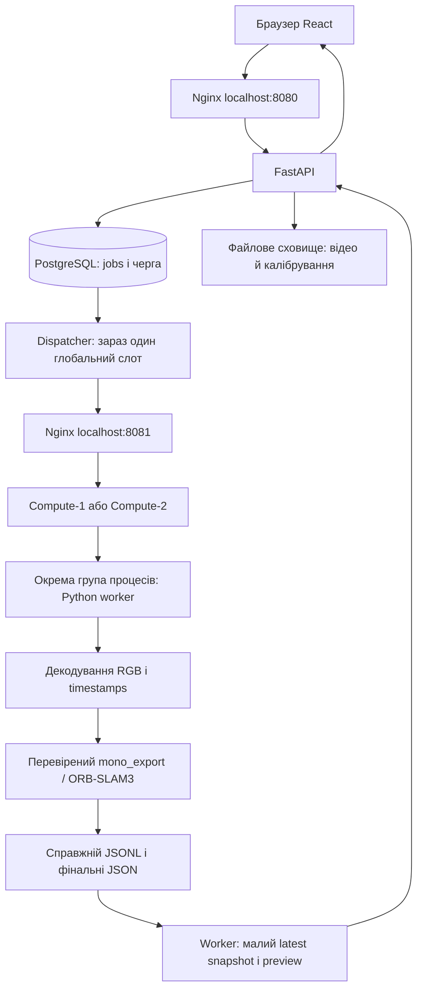

# Як працює MonoTrajectoryWeb

Користувач завантажує **записане монокулярне відео** та параметри камери. ORB-SLAM3 оцінює рух цієї камери й розріджені 3D-точки. Браузер поступово показує отримані дані, а після завершення відкриває збережений результат. Це не щільна фотореалістична модель і не локалізація у раніше збереженій кімнаті. Актуальні докази та залишок вимог — у [day1-report.md](day1-report.md).

## Шлях відео до обчислення

POST `/api/jobs` приймає файл, перевіряє параметри й записує задачу в БД, після upload швидко повертає 202 та UUID. Сам SLAM виконується пізніше. Dispatcher атомарно резервує queued-запис; compute перевіряє reservation та статус і запускає worker окремим дочірнім процесом. Це відокремлює важке обчислення від HTTP обслуговування: API залишається доступним, а задачу можна припинити.

Worker через PyAV/FFmpeg декодує відео у RGB PNG та `rgb.txt` з presentation timestamps, відліченими від першого кадру. Перевірки розміру/тривалості/кількості кадрів і калібрування діють також під час декодування. Resize і пропуску кадрів заради швидкості немає. Згенерований YAML передає явні intrinsics/distortion наявному `mono_export`; TUM-профіль застосовується тільки за окремим вибором для відомого TUM-ролика.

## Звідки беруться поза і точки

ORB-SLAM3 знаходить та зіставляє візуальні ознаки між кадрами, використовує їх спільні спостереження для оцінки руху й 3D-положення точок та уточнює карту. Наш код не реалізує власний SLAM: тонкий exporter отримує числові копії справжніх поз/точок із перевіреного ядра. У вхід не подаються depth або ground truth. `frame_id` — монотонний номер вхідного кадру, не номер keyframe й не лічильник tracking; для тестового ролика це 0–797.

`Tcw` перетворює координати світу в координати камери. Для положення камери у світі потрібна **`Twc = inverse(Tcw)`**: її translation задає положення центру камери, rotation — орієнтацію. Export перевіряє скінченність чисел, одиничний quaternion xyzw, ортонормальність і determinant +1. Для Three.js застосовано один узгоджений поворот `C=diag(1,-1,-1)` і до точок, і до камери: `C4 Twc C4^-1`, де `C4=diag(1,-1,-1,1)`.

За одним RGB-відео абсолютний розмір сцени невідомий: більша сцена й пропорційно більший рух можуть давати ті самі зображення. Калібрування задає геометрію проєкції, але саме по собі не задає довжину еталона. Тому координати **у відносних одиницях**, називати їх метрами не можна.

Якщо пози немає, запис має null, tracking_state і причину недоступності; координати не інтерполюються. Навіть tracking OK не гарантує доступну узгоджену позу в нашому snapshot. Різні map_id/segment_id та невалідні/відсутні кадри розривають лінію. Live-пози — історичні оцінки під час обробки, final-пози — оптимізована доступна підмножина; їх кількості можуть різнитися. У найновішому тесті це 685 live та 438 final, а не 38 keyframes старого baseline.

## Де лежать задачі й дані

PostgreSQL зберігає UUID, parameters, status/stage, лічильники, час, server_id, cancel flag, reservation, PID/start identity, помилку та відносні посилання. У поточному прототипі owner_id=null — справжньої власності ще немає. Міграція Alembic описує таблицю jobs.

Відео, робочі PNG, calibration, JSONL, previews, логи та великі фінальні масиви лежать у native WSL: `~/.local/share/monotrajectoryweb/web/jobs/<UUID>`. Вони не комітяться. БД і файли зберігаються після перезапуску; автоматичного відновлення перерваного SLAM немає. Основний репозиторій залишається у початковій Windows-папці; native WSL не є додатковим Git checkout. Поточний VHDX фізично на C:, тому резерв цього диска перевіряється окремо.

Лише нові задачі мають cleanup marker. Перед публікацією snapshot відповідний PNG зберігається як preview hardlink; після завершення процесів робочий `sequence/rgb` прибирається. Відео, previews, JSONL, результати й логи залишаються. Початкові 29 задач не очищалися. Загального ліміту кількості збережених задач/retention поки немає, 10 pending — окремий ліміт незавершених задач.

## Прогрес, карта, скасування й timeout

Worker читає JSONL поступово й атомарно замінює малий `latest.json`, приблизно раз на 0,5 с: frame_id, processed_frames, total за наявності, stage, tracking, Twc/null, до 256 точок і 240 записів історії. API читає тільки latest, не весь багатомегабайтний JSONL. Браузер завантажує preview цього frame_id, перевіряє заголовок і тільки тоді одночасно показує кадр та карту. Оновлення походять із результатів обчислення; таймер задає частоту GET, а не рух камери.

Після завершення frontend окремо читає manifest і final trajectory/map_points. Він не з'єднує прогалини, обмежує GPU-буфери, припиняє polling після terminal/закриття й звільняє сцену. Фінальна карта перевіряється не лише exit code: worker очікує завершені потоки/відсутній GBA та порівнює два узгоджені geometry snapshots. Штучних затримок для анімації немає.

POST `/cancel` ставить cancel flag у PostgreSQL; queued-задача може завершитися без запуску. Для running compute помічає flag, перевіряє власність PID/start identity й припиняє всю створену process group через TERM, за потреби KILL. Він очікує завершення, прибирає залишені дочірні процеси й перевіряє порожню групу перед звільненням слота та cleanup. Одного закриття вкладки чи зміни status у БД для цього недостатньо.

Execution timeout починається при виконанні на compute, охоплює decode і native pipeline; очікування у черзі виключене. Після перевищення діє той самий механізм припинення групи. У поточних доказах після cancel/error/timeout немає живих worker/native-процесів; точні результати — у звітах backend/frontend.

## Що робить балансувальник зараз і що залишилося

Nginx має upstream двох незалежних compute HTTP-процесів; dispatcher надсилає `/execute` через нього, різні послідовні задачі вже виконувалися на різних server_id. Проте dispatcher має **один глобальний слот** і чекає завершення запиту, тому два одночасні обчислення ще неможливі. Два health endpoint не є доказом R5.

Наступний окремий етап має узгодити зайнятість двох слотів із reservation/маршрутизацією, показати реальне перекриття роботи двох відео через Nginx і отримати обидва результати. Одне відео обробляється послідовно одним compute; балансування розподіляє різні задачі. ETA, автоматичний запуск нового сервера з верхньою межею та адмінпанель із метриками ще відсутні. Авторизація/власність і HTTPS теж заплановані; поточний доступ — лише localhost.

## Шість питань для самоперевірки

1. **Навіщо окремий процес, якщо вже є API?** Важкий SLAM працює незалежно від HTTP handler; API може відповідати про стан, а менеджер — припинити весь процес задачі з дочірнім native runner.
2. **Чому масштаб не в метрах, хоча є калібрування?** Калібрування задає проєкцію, але монокулярне RGB не дає відомої фізичної довжини. Без зовнішнього масштабу траєкторія й точки залишаються відносними.
3. **Як відрізнити реальні проміжні дані від анімації?** Snapshot має фактично оброблений frame_id, tracking, числові оцінки й відповідний RGB; записи/карта змінюються до завершення живого процесу. Таймер лише опитує API, координат він не створює.
4. **Чому два запущені compute ще не доводять балансування?** Поточний dispatcher послідовний. Для R5 потрібні дві різні реальні задачі з перекриттям обчислення через Nginx на різних server_id та коректні результати, а не тільки health 200.
5. **За що відповідає PostgreSQL?** За метадані, персистентну чергу, стан, reservation, cancel і посилання. Великі відео/JSONL/геометрія зберігаються файлами; БД не виконує SLAM і її пароль не є вебавторизацією.
6. **Чи достатньо поставити задачі status=cancelled?** Ні. Менеджер має реально припинити власну process group, дочекатися завершення всіх її членів і звільнити слот; тільки потім безпечно очищати робочі кадри, зберігши previews/результати.

Push не виконувався.
