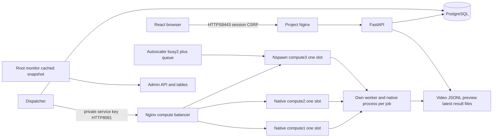

# Як працює MonoTrajectoryWeb та як його захищати

Актуально після фінального приймання06.11.2026. [Матриця точних R1–R8, докази, команди й ручні дії](final-acceptance.md). Історичний аудит Промпта5 залишається в [day1-report.md](day1-report.md); наведені там незавершені етапи вже закриті наступними перевірками.

Користувач завантажує записане монокулярне RGB-відео та явне калібрування. Backend виконує справжню оцінку руху камери й розріджених3D-точок, під час роботи віддає прогрес і карту, а результат зберігає. Масштаб **відносний**: калібрування не дає фізичного метра. Пропущені пози залишаються null, прогалини й межі карт/сегментів не з'єднуються. Живий стрим, збережена кімната для relocalization і щільна фотореалістична модель поза темою.

## Шлях запиту

Nginx користувацького входу й compute-balancer — конфігурації одного проєктного Nginx. Усе прив'язано до loopback. HTTPS8443 — canonical origin; HTTP8080 лише GET/HEAD redirect. Приватні HTTP API8000, balancer8081 та compute8101–8103 не замінюють авторизацію: користувацький forwarding має окремий proxy key, службовий execute — service key. Звичайна browser session не дає службових прав.

POST `/api/jobs` перевіряє сесію/CSRF, параметри та upload cap; записує файл і атомарно приймає job у PostgreSQL. HTTP202 швидко повертаєid, важке обчислення не тримає request handler. Глобальні100 stored усіх станів і10 pending — різні межі; старі jobs не видаляються автоматично. Історія повертає лише owner jobs,20/page/max100, детермінований created_at/id. Для чужого job404, без входу401.

Dispatcher атомарно резервує готову FIFO job і вільну місткість PostgreSQL. Один compute має один слот; базово два, при autoscale максимум три. Dispatch іде через Nginx; busy409 повторює той самий reservation token, не створює дубль worker. Running job після restart dispatcher повторно не запускається. Стани, PID identity, процеси й файли різних jobs ізольовані.

## CV: лише вхід, вихід і прогрес

Worker через PyAV декодує відео без зміни роздільності в RGB PNG та індекс із реальних PTS. Перевіряються duration/frame/resolution/time/disk caps **під час** decode, а не тільки header metadata. Калібрування має точно відповідати розміру; для сторонньої камери TUM profile не підставляється.

Уже зібраний офіційний ORB-SLAM3 `mono_export` отримує RGB sequence, timestamps і calibration. Вихід — справжні frame records JSONL: монотонний input frame_id, timestamp, tracking_state, Twc або null, map_id/segment_id, sparse points; після завершення — `trajectory.json`, `map_points.json`, summary. Twc — положення камери у світі, inverse від Tcw ядра. Власний SLAM не розроблявся, прихована depth/ground truth не використовується. Відомий ABI fix `-march=native` і перевірені залежності збережені; збирання для демонстрації не потрібне.

Worker поступово читає JSONL і атомарно замінює маленький `latest.json` приблизно раз0,5с: frame/progress/tracking/pose, до256 точок і240 записів траєкторії. API не перечитує весь JSONL на кожен poll. Браузер спочатку отримує preview саме цього frame_id, потім показує узгоджені кадр/карту. Таймер задає частоту GET, координат не вигадує.

Після terminal polling припиняється; закриття сторінки скасовує requests і звільняє GPU geometry/materials/context. Three.js має обмежені буфери; показується одна карта/сегмент, прогалини не інтерполюються. Фінальний результат перевіряється за числовими позами/кватерніонами/точками й узгодженістю двох знімків геометрії після завершення потоків; exit0 недостатньо.

Cancel API ставить cancel flag; queued job завершується без native. Compute зупиняє тільки власну process group, TERM/KILL→wait/reap, перевіряє відсутність усіх PID, включно із zombie, потім звільняє слот. Execution timeout1–180с використовує той самий шлях і не включає queue wait. Після завершення/помилки/cancel нові jobs очищають робочі RGB, зберігаючи input video, published preview й результати. Початкові29 jobs не піддавалися новому cleanup; окремого retention manager немає.

## Черга, розширення й моніторинг

FIFO розв'язує однакові created_at черезid. Позиція й ETA доступні лише для власної queued job, іншим станам null. Оцінка використовує median успішного worker wall без queue time, frame/resolution metadata та прогрес активних jobs; розкладає роботи по всіх ready slots. Cold start конфігурований, default45с на360frames640×480, може бути вимкнений. ETA приблизний, не гарантований; JSONL для нього не читається.

Коли обидва базові compute зайняті й є черга, root controller атомарно резервує старт третього. systemd-nspawn створює справжні PID/mount/filesystem namespaces; ядро, venv і потрібні ресурси bind-mounted read-only, запис тільки в потрібні runtime каталоги. Після health і успішного nginx config-test/reload сервер стаєready й отримує один слот. Starting теж враховується в max3. Failure/cooldown/retry не гублять jobs; автоматичного scale-down немає. Контейнер використовує той самий Linux kernel/WSL RAM/loopback, окремої ВМ або фізичного вузла немає.

Admin роль default false, надається тільки локально явному існуючому login. Кожний admin API перевіряє backend ACL; admin не обходить owner на звичайних jobs. Панель read-only: службові стани, native/container slots/currentjob, queue/ETA, host/container PID, uptime, CPU/RSS, одна спільна WSL CPU/RAM. Collector кешує2с, TTL6с, недоступне/null/stale показує явно. CPU процесу100%=один logical CPU; загальна CPU0–100% усіх CPU; RSS bytes/API та MiB/UI. RSS спільних сторінок не є окремою RAM кожної машини. Паролі/токени/env/сирі argv не повертаються.

## Де шукати код

| Частина | Файли |
| --- | --- |
| Frontend/form/history/map | `frontend/src/App.tsx`, `useJob.ts`, `useHistory.ts`, `MapView.tsx`, `data.ts`, `types.ts` |
| API, upload/artifacts/owner | `backend/mtw/api.py`, `contracts.py`, `files.py` |
| PostgreSQL models/migrations | `backend/mtw/db.py`, `backend/migrations/versions/0001_jobs.py` … `0006_admin_role.py` |
| Accounts/sessions/CSRF/proxy | `backend/mtw/auth.py`, `proxy.py`, `service_auth.py`, `frontend/src/Auth.tsx` |
| HTTPS/start/status/stop/Nginx | `backend/mtw/tls.py`, `control.py:write_nginx`, `scripts/setup-https`, `scripts/start`, `scripts/status`, `scripts/stop` |
| Dispatcher/atomic slots | `backend/mtw/dispatcher.py`, `scheduler.py`, `compute.py`, `processes.py` |
| Video/CV/progress/cleanup | `backend/mtw/video.py`, `worker.py`, `frame_work.py`, `capacity.py`, `native/cv/mono_export.cc`, `scripts/cv/` |
| ETA | `backend/mtw/queue_eta.py`, `frontend/src/queue.ts` |
| Autoscaling/container | `backend/mtw/autoscaler.py`, `servers.py`, `container_runtime.py`, `scripts/container/` |
| Admin metrics/roles | `backend/mtw/admin.py`, `monitoring.py`, `metrics.py`, `admin_role.py`, `frontend/src/Admin.tsx`, `adminPolling.ts`, `scripts/admin-role` |
| Config/API contract | `config/local.toml`, `docs/api-contract.md` |

Великі CV sources/build/dependencies/datasets і `web/jobs`, PostgreSQL, TLS/ключі залишаються `/home/demus/.local/share/monotrajectoryweb` поза Git, у native FS WSL. VHDX фізично наC:, тому перевіряється також backing reserve5GiB. Репозиторій не дублювався й не переносився.

## Сценарій захисту на5–7хв

До показу: `scripts/start`, `scripts/status`, HTTPS8443, готові10с MP4+JSON640×480; точні PowerShell команди й UNC paths у [final-acceptance.md](final-acceptance.md). Користувач сам вирішує, чи встановити CA й надати своєму login admin; ці дії не виконуються автоматично. Production admins0 і legacy51 unowned — очікувана безпечна конфігурація. Не вводьте паролі в презентацію/terminal history. Якщо не хочете створювати нову job, відкрийте власний збережений результат і native live screenshots; прямо зазначте, що це попередній записаний доказ.

| Час | Дія та пояснення |
| --- | --- |
| 0:00–0:40 | Сформулювати тему: записане RGB+калібрування→відносні sparse points/траєкторія, без metric scale чи dense room. Показати схему browser/API/PG/dispatcher/Nginx/compute. |
| 0:40–1:25 | Увійти через HTTPS, показати власну історію й R1 limits64MiB/40с/1200/1280×720/180с. За готовності диска створити **одну** job готовим10с відео+paired calibration; HTTP202, обчислення в іншому процесі. |
| 1:25–2:20 | Показати decode/init/tracking, фактичні кадри й малий snapshot, RGB/frame_id і поступову карту. Пояснити null/segments/відносні одиниці; таймер лише poll. Якщо обчислення ще триває, перейти до доказів і повернутися до результату. |
| 2:20–3:10 | Відкрити готовий результат, числаframes/live/final/points, JSONL artifacts; reload зберігає history/result/session. Пояснити різницю live pose й final subset, worker wall включає decode/pacing/export. Показати збережений full restart proof73 jobs. |
| 3:10–4:20 | Найважливіше R5: два різні server_id/PID, Nginx access log, CPU/tracking overlap≥10,140с і два валідних outputs. Пояснити PG reservation/idempotency/один слот і cancel/timeout isolation. Без повторного паралельного run. |
| 4:20–5:15 | R6: queued screenshot, position1, ETA20,3с проти19,329с; FIFO й модель ready slots. R7: busy2+queue→nspawn compute3, namespace evidence, Nginx8103, valid container job, max3 including starting. |
| 5:15–6:10 | R4/HTTPS і R8: Secure cookie, CSRF, ownership401/404, admin401/403/200. Відкрити `/admin` лише з вручну наданою роллю або показати R8 screenshots; пояснити CPU/RSS scales, stale, host/container PID і read-only scope. |
| 6:10–6:50 | Показати матрицю R1–R8 й карту файлів, згадати Chrome trust status, shared kernel і приблизний ETA. Питання викладача; після показу `scripts/stop`, за потреби `scripts/stop postgres`. |

## Питання й короткі відповіді

1. **Чому API не блокується на SLAM?** HTTP202 повертає після admission; dispatcher/compute запускають окремий child worker/native. GET стану не чекає його завершення.
2. **Чому не метри?** Одне RGB відео без зовнішньої відомої довжини не визначає абсолютний масштаб; intrinsics задають проєкцію, не фізичну відстань.
3. **Як доведено справжній прогрес?** JSONL й snapshots містять input frame_id/tracking/pose/points, змінюються до terminal; показаний preview має той самий frame. Live canvas screenshots різні, координати походять з ядра.
4. **Як доведено балансування?** Дві різні відеозадачі на різних compute через Nginx, перекриття саме native PID/CPU ticks/tracking і два validated results; health200 недостатньо.
5. **Чому PostgreSQL важливий?** Транзакційні admission/claim/reservation, черга й стан переживають restart; також users/sessions/ownership/roles/registry. Великі масиви й відео файлові, БД зберігає metadata/references.
6. **Чи достатньо status=cancelled?** Ні: потрібно припинити всю відповідну process group, wait/reap, звільнити слот і тільки потім прибрати робочі кадри. Сусідній job не повинен постраждати.
7. **Чим ETA відрізняється від відсотка?** ETA — прогноз очікування до старту, із попередніх execution durations і поточної черги/слотів. Відсоток — фактично оброблені кадри поточної job. Обидва не гарантують якість tracking.
8. **Чи третій сервер справді контейнер?** Так: systemd-nspawn, окремі mount/PID/filesystem namespaces, перевірені host/local PID та RO resources. Kernel/RAM спільні, це не третя незалежна фізична машина.
9. **Чому HTTPS у Chrome має попередження?** Сертифікат валідний для localhost/127.0.0.1 і перевірений curl з явним CA, але приватний локальний CA ще не встановлений у trust store. Функціональні browser tests з ignoreHTTPSErrors не доводять browser trust.
10. **Чи admin бачить чужі artifacts?** Admin monitoring має загальні metadata/processes, але звичайні job endpoints зберігають ownership404. Самостійно підвищити роль через registration/API не можна.
11. **Чому58 тестів стали56?** Різні subsets: спільні47; R7 додатково history7/container-stop4, R8 додатково admin5/metrics4. Це58−11+9, не два зниклі тести. Точні команди в final acceptance.

Push не виконувався.
